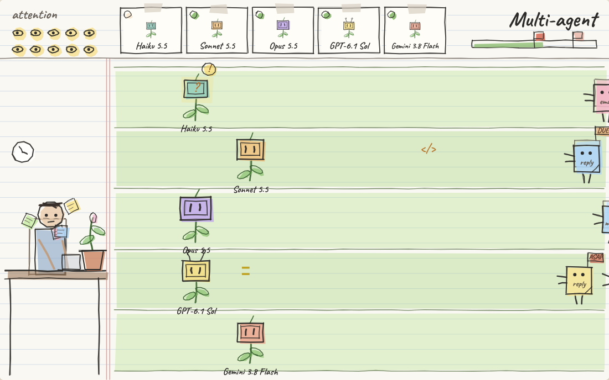

# Agents vs. Tasks

*Human attention is all you need.*

A small sketchbook lane-defense game about what happens to your own thinking when you run more and more AI agents at once.

**[Play it in your browser →](https://stanley-zhou.github.io/playable-thoughts/agents-vs-tasks/)**

## The thought

LLM agents can run in parallel, so we start running several at once. One agent works, and you go check on another. It feels efficient, but the whole process gets sped up so much that your own thinking falls away. Your attention gets pulled apart, and you end up running on autopilot, like a zombie.

Models got better because of attention. In the age of parallel agents, the scarce thing is ours: one person's whole, unbroken attention.

## How to play

- Click the falling yellow eyes to collect **attention**.
- Spend it to plant an **agent**. Agents clear the **tasks** walking toward your desk.
- Now and then an agent stops and asks for a **review**. Click it to keep it going.
- The pot on your desk holds **your own thought**. It only grows while you stop clicking.
- Tasks that get past an agent don't go away. They get stuck in your head.

There are no scores. What you end up with is whatever grew in the pot.

## Three stages

| Stage | What happens |
|---|---|
| **Single agent** | One lane, one agent. Plant it, let it work, and you have room to think. |
| **Multi-agent** | Five lanes, one model each: Haiku 5.5, Sonnet 5.5, Opus 5.5, GPT-6.1 Sol, Gemini 3.8 Flash. Each one asks for reviews on its own rhythm. |
| **Army of agents** | Agents spawn subagents and the lanes keep doubling. You can't keep up. |

The colors drain a little more with every stage.

## Design notes

The game went through four versions. [NOTES.md](NOTES.md) records what changed in each one and why.

## Credits

- Inspired by *Plants vs. Zombies* by PopCap Games. This is an unofficial tribute, not affiliated with or endorsed by PopCap or EA.
- The agents are named after real models just for fun. Their powers and habits are made up and say nothing about how the real models compare.
- Concept, design and playtesting by Stanley Zhou. Code written with [Claude](https://claude.ai) (Anthropic) as a collaborator.
- Fonts: [Caveat](https://fonts.google.com/specimen/Caveat) and [Patrick Hand](https://fonts.google.com/specimen/Patrick+Hand), SIL Open Font License, loaded from Google Fonts.

## Background reading

- [*AI brain fry*](https://the-decoder.com/study-warns-of-ai-brain-fry-as-workers-hit-cognitive-limits-overseeing-ai-agents/): BCG's 2026 survey of 1,488 workers on the mental cost of overseeing AI agents.
- [Attention residue](https://www.uwb.edu/business/faculty/sleroy/attention-residue): Sophie Leroy's research on how part of your attention stays behind on an unfinished task.
